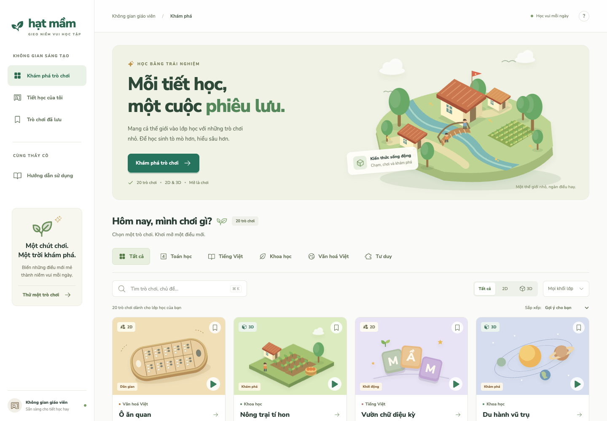

# Dự án Game giáo dục cho giáo viên

**Tên giao diện:** Hạt Mầm.

Thư viện 20 trò chơi giáo dục tiếng Việt: 10 game 2D xen kẽ 10 game Three.js, dành cho hoạt động trên lớp và học qua trải nghiệm.



## Trải nghiệm

- Tìm kiếm không cần gõ dấu, lọc theo môn học, khối lớp và 2D/3D.
- Mỗi trò có minh hoạ riêng, mục tiêu học tập, hướng dẫn, phản hồi và chơi lại.
- Lưu trò yêu thích, soạn tên/mục tiêu tiết học, chọn và sắp xếp trò chơi thành hành trình.
- Trình chiếu toàn màn hình, bật/tắt âm thanh, theo dõi thời gian và kết quả gần đây.
- Giao diện điện thoại, thao tác chạm, bàn phím và nút thay thế cho lựa chọn 3D.
- Phông chữ có dấu tiếng Việt được lưu cùng ứng dụng. Không cần dịch vụ hình ảnh hay font bên ngoài khi chạy.

## 20 trò chơi

| Game 2D            | Cơ chế                               | Game 3D             | Cơ chế                         |
| ------------------ | ------------------------------------ | ------------------- | ------------------------------ |
| Ô ăn quan          | Rải hạt, ăn quân, hai đội luân phiên | Nông trại tí hon    | Ghép cây với môi trường sống   |
| Vườn chữ diệu kỳ   | Sắp xếp chữ cái tiếng Việt           | Du hành vũ trụ      | Nhớ thứ tự 8 hành tinh         |
| Lật thẻ trí nhớ    | Ghép hình và tên                     | Kỹ sư xây cầu       | Ghép thanh theo tổng chiều dài |
| Bếp bánh phân số   | Tô phần bánh theo phân số            | Xưởng khối hình     | Đếm khối hộp, cầu, nón         |
| Đuổi hình bắt chữ  | Suy luận cụm từ từ hình              | Đua thuyền ngày hội | Chọn làn bằng phép cộng        |
| Đường về nhà       | Tìm đường, lấy đủ vật phẩm           | Phòng pha màu       | Phối hai màu theo mô hình RYB  |
| Nhịp điệu vui      | Nhớ và lặp chuỗi nốt                 | Truy tìm hóa thạch  | Khai quật và ghép cặp          |
| Biệt đội phân loại | Phân loại rác                        | Dọc miền đất Việt   | Ghép địa danh với vùng miền    |
| Sudoku sắc màu     | Điền bảng 4×4                        | Thành phố xanh      | Cân đối chi phí và điểm xanh   |
| Mật mã kho báu     | Giải quy luật số/hình                | Phố đèn lồng        | Hoàn thành mẫu lặp màu         |

## Chạy trên máy

Yêu cầu Node.js 20.19+ hoặc 22.12+ và npm.

```sh
npm ci
npm run dev
```

Mở địa chỉ được in trong terminal. Vite mặc định dùng cổng 5173 và tự chọn cổng tiếp theo nếu đang bận.

```sh
npm run build
npm run preview
```

Thư mục `dist/` là website tĩnh có thể triển khai lên hosting. `base: './'` hỗ trợ đường dẫn thư mục con. Điều hướng game dùng hash (`#play/nong-trai`), không cần cấu hình rewrite máy chủ.

## Kiểm thử

```sh
npx playwright install chromium
npm run dev -- --port 5174 --strictPort
# Trong terminal khác:
npm test
```

Nếu đã cài Google Chrome, có thể dùng `PW_CHANNEL=chrome npm test`. Bộ kiểm thử gồm đường hoàn thành của cả 20 trò, chơi lại, tìm kiếm/lọc/lưu, soạn tiết học, điều hướng và bố cục điện thoại. Kết quả kiểm tra thực tế được ghi trong [docs/QA.md](docs/QA.md).

## Cấu trúc

```text
src/
  App.jsx              Thư viện, trình soạn tiết học, màn chơi
  catalog.js           Mục tiêu, môn học, khối lớp, hướng dẫn
  GameArt.jsx          21 cảnh minh hoạ SVG nguyên bản
  styles.css           Giao diện responsive
  games/
    Games2D.jsx        10 cơ chế game 2D
    Games3D.jsx        10 cơ chế game + bộ dựng cảnh Three.js
public/                Biểu tượng ứng dụng
screenshots/           Ảnh chụp từ ứng dụng thực tế
tests/                Kiểm thử Playwright
```

React 19 + Vite + Three.js. Hai bộ game tải theo nhu cầu; thư viện không khởi tạo WebGL. Cảnh 3D giải phóng geometry, material, texture, renderer và trình xử lý sự kiện khi thay cảnh. Âm thanh tổng hợp bằng Web Audio.

## Phạm vi phiên bản

Không có đăng ký, đăng nhập, database hoặc API. Dữ liệu yêu thích, tiết học và kết quả nằm trong `localStorage` của trình duyệt hiện tại, không đồng bộ giữa thiết bị. Trò chơi dùng nội dung tích hợp sẵn; chưa có trình biên soạn bộ câu hỏi tuỳ chỉnh hay phòng chơi nhiều thiết bị. Ô ăn quan là bản luật lớp học giản lược; sa bàn vùng miền không phải bản đồ địa lý; hành tinh không đúng tỉ lệ; pha màu RYB là mô hình màu vẽ giản lược. Khối lớp và thời lượng là gợi ý để giáo viên lựa chọn.

Các thành phần có thể nối backend sau: thay lớp lưu cục bộ, tách dữ liệu bài tập khỏi cơ chế, bổ sung tài khoản và đồng bộ bài giảng. Không có thông tin học sinh được gửi đến máy chủ.

## Nghiên cứu và thiết kế

Xem [docs/RESEARCH.md](docs/RESEARCH.md). Trang tham khảo Giáo viên Đổi mới yêu cầu đăng nhập, vì vậy nghiên cứu chỉ ghi nhận phần công khai; Wordwall và Toy Theater được dùng để tham khảo cách tổ chức hoạt động giáo dục. Không sao chép thương hiệu, mã nguồn hoặc ảnh từ các nguồn này.

Màu xanh sân trường, nền sáng và cảnh làng Việt tạo một không gian nhẹ nhàng để giáo viên tập trung chọn hoạt động. Minh hoạ, mô hình hình học và âm thanh được tạo trực tiếp trong dự án.
